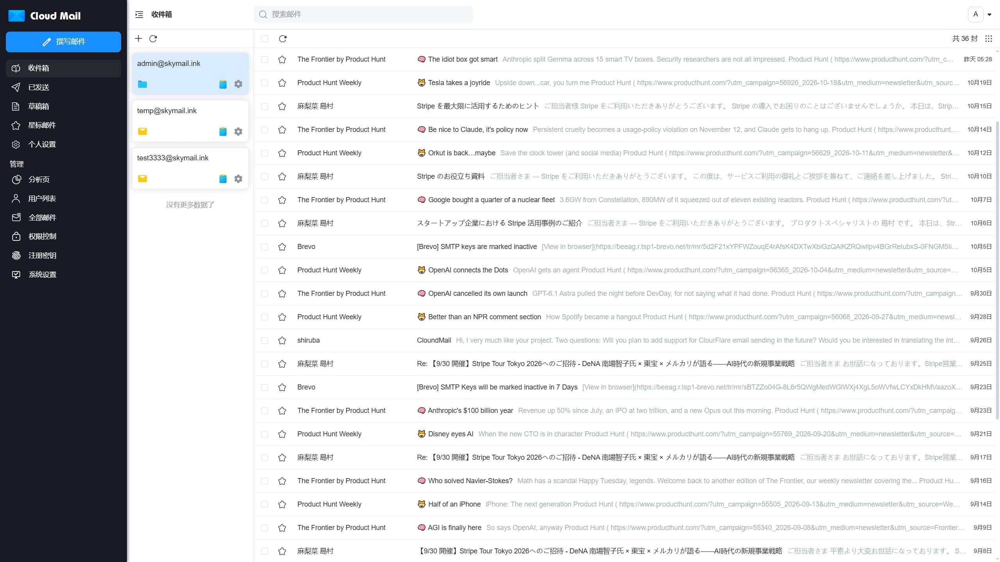
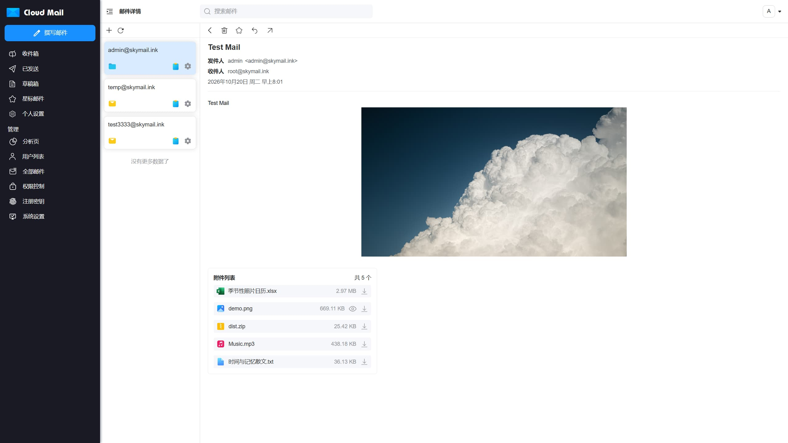
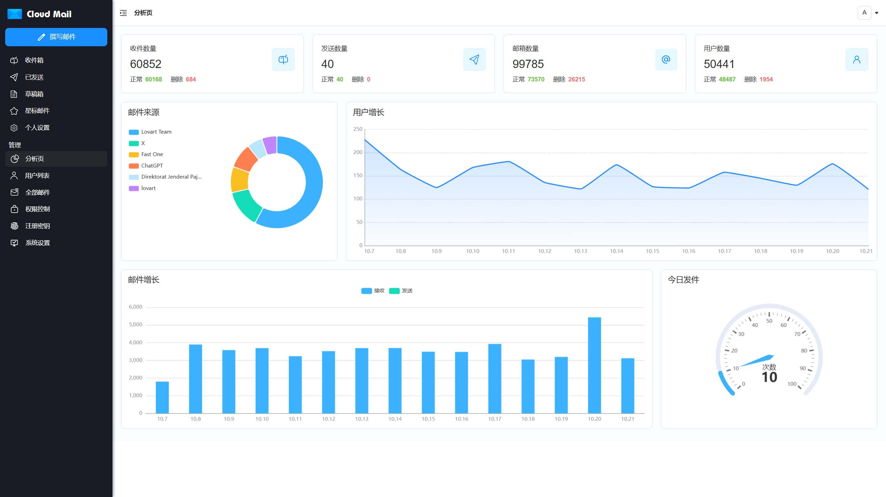
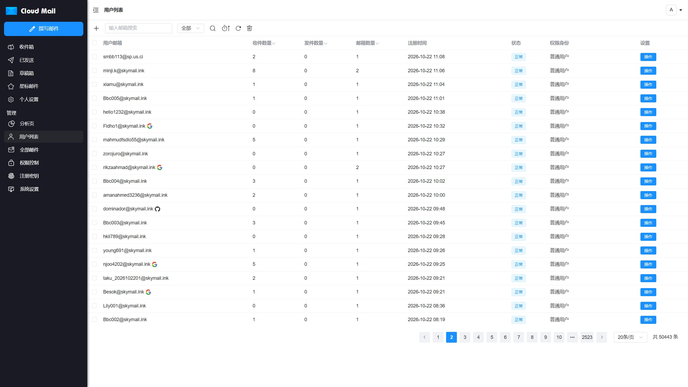

<p align="center">
    
    <h1 align="center">Cloud Mail</h1>
    <p align="center"><strong>基于 Cloudflare 的一站式邮箱服务平台</strong></p>
    <p align="center">
        <a href="https://www.cloudflare.com/" target="_blank">
            
        </a>
        <a href="https://github.com/kay-King/cloud-mail/releases" target="_blank" >
            
        </a>
        <a href="https://github.com/kay-King/cloud-mail/tree/main?tab=MIT-1-ov-file" target="_blank" >
            
        </a>
    </p>
    <p align="center" >
        <a href="https://skymail.ink">在线演示</a> · <a href="https://docs.skymail.ink">部署文档</a> · <a href="DEPLOY.md">本 fork 详细部署说明</a> ·
        <a align="center"><a href="README-en.md">English</a> | 简体中文 | <a href="README-ja.md">日本語</a></a>
    </p>
    <p align="center">
        <a href="https://trendshift.io/repositories/20459" target="_blank" >
            
        </a>
        <a href="https://hellogithub.com/repository/1b1da1f9ae4c4175baa3d762b4e0ba41" target="_blank">
            
        </a>
    </p>
</p>


## 项目简介

只需要一个域名，就可以创建多个不同的邮箱，类似各大邮箱平台，本项目支持部署到 Cloudflare Workers ，降低服务器成本，搭建自己的邮箱服务

**本仓库是 [maillab/cloud-mail](https://github.com/maillab/cloud-mail) 的 fork**，在原项目的基础上增加了按账号转发、回收站、附件管理、邮件导出/导入、数据备份、操作记录、界面主题、登录背景壁纸库等功能（完整清单见下节）。新增功能全部在网页设置里配置，不用改代码；部署方式与原项目一致，零改动即可部署，详见 [DEPLOY.md](DEPLOY.md)。

> English / 日本語 版本为上游原版说明，仅本中文版包含本 fork 的新增功能。


## 本 fork 新增功能

| 功能 | 说明 | 在哪里用 |
|---|---|---|
| 按账号转发 | 每个邮箱独立的转发开关与目标地址，不再是全站一个转发设置 | 个人设置 → 邮件转发 |
| 转发失败提醒 | 转发失败后站内提醒该邮箱的拥有者，同一地址 30 分钟内只提醒一次 | 自动触发 |
| 转发自动添加 | 保存转发目标时自动把地址加进 Cloudflare 验证名单并触发验证邮件 | 保存转发时自动（需配 Token，见 [DEPLOY.md](DEPLOY.md)） |
| 系统通知邮箱 | 转发失败提醒、管理员删除通知、备份失败提醒统一从这个邮箱发出 | 系统设置 → 邮件推送 → 系统通知邮箱 |
| 回收站 | 删除先进回收站，可恢复；回收站里彻底删除才是真删 | 左侧菜单 → 回收站 |
| 管理员删除通知 | 管理员删除别人的邮件或附件时，可发站内通知告知对方（可填原因） | 删除时弹通知确认框；系统设置里可关 |
| 我的附件 / 全部附件 | 附件集中管理：搜索、按类型筛选、收藏、下载、发送；管理员看全站附件，同一文件只显示一次 | 左侧菜单 → 我的附件；管理菜单 → 全部附件 |
| 附件单独删除 | 只删附件不删邮件；文件对象等最后一个引用删掉时才真正删除 | 附件页勾选删除 |
| 附件点击预览 | 图片、PDF、纯文本、音视频点开直接看；docx / xlsx / pptx 在浏览器里本地解析预览，不走第三方服务 | 附件页 / 邮件详情页点附件 |
| 附件加密存储 | 附件以 AES-256-GCM 加密后存储，钥匙由系统自动生成存在 KV 里，可一键轮换，旧钥匙保留解密旧附件 | 系统设置 → 附件加密 |
| 存储四选 | 附件与备份的目的地均为 S3 兼容存储 / Cloudflare R2 / WebDAV / KV 四选，KV 免配置、默认兜底；切换存储后旧附件照常可读 | 系统设置 → 附件存储 / 数据备份 |
| 邮件导出 / 导入 | 单封导 .eml、多封打 zip 导出；.eml / .zip 导入，同 Message-ID 自动跳过 | 列表工具栏导出；个人设置 → 导入邮件 |
| 数据备份与恢复 | D1 全库 + KV 全量定时备份（每天一次，保留 7 份），手动导出下载明文文件，上传备份可覆盖恢复 | 系统设置 → 数据备份 |
| 备份失败提醒 | 定时备份或手动备份失败时，站内通知管理员（24 小时内只提醒一次） | 自动触发 |
| 操作记录 | 只记管理操作（删邮件/附件/用户、禁用/恢复用户、改设置、改角色），可按操作人/类型/日期筛选，可删除与自动清理 | 管理菜单 → 操作记录（仅管理员） |
| 界面主题 | 7 套品牌风主题（默认 / Gmail / Outlook / QQ 邮箱 / Apple Mail / 163 邮箱 / Yahoo），与深浅模式叠加；侧栏 Logo 与选中菜单图标跟随品牌配色 | 个人设置 → 主题样式 |
| 登录背景壁纸库 | 15 张会动的纯 CSS 壁纸（晨曦、落日、星空、海洋、樱花、极光、流星雨、光束、落雪、彩晕、海浪、沙滩、蝴蝶、热气球、晨光）+ 默认云朵 | 系统设置 → 登录背景 |
| 背景图自动压缩 | 本地上传的背景图超 512KB 时浏览器内先压缩再上传（动图跳过压缩保动画） | 系统设置 → 登录背景 → 本地上传 |
| 邮箱容量统计 | 分析页新增「邮箱容量」卡，显示 D1 数据库总大小（上限 500MB） | 分析页 |
| 加载优化 | 应用外壳与静态资源离线缓存、邮件列表双请求并行、启动自救与 chunk 加载失败静默自动恢复，慢网下打开更快更稳 | 自动生效 |

## 项目展示

|   |  |
|--------------------------|--------------------------|
|  |  |


## 推荐项目

<table>
  <tr>
    <td valign="middle">
      <a href="https://github.com/pixtalelab/pixtale">
        
      </a>
    </td>
    <td valign="middle">
      <a href="https://github.com/pixtalelab/pixtale">Pixtale</a>
    </td>
    <td valign="middle">
      一个自托管云存储相册应用
    </td>
  </tr>
</table>

## 功能介绍

- **💰 低成本使用**： 可部署到 Cloudflare Workers 降低服务器成本

- **💻 响应式设计**：响应式布局自动适配PC和大部分手机端浏览器；附件页与操作记录页在手机上是卡片列表，列表均为无限滚动

- **📧 邮件发送**：集成 Cloudflare Email、Resend、Sendkit、Brevo 发送邮件，支持群发；按发件域名自动选择已配置的服务商，多个服务商可同时配置

- **🛡️ 管理员功能**：可以对用户，邮件进行管理，RBAC权限控制对功能及使用资源限制；管理员删除别人的邮件或附件时可通知对方

- **📦 附件收发**：支持收发附件，存储可选 S3 兼容存储 / R2 / WebDAV / KV；附件 AES-256-GCM 加密存储；邮件列表里内嵌图片与真正附件用不同图标区分

- **🔔 邮件推送**：接收邮件后可以转发到TG机器人或其他服务商邮箱；转发按邮箱独立配置，失败有站内提醒，保存时可自动添加验证名单

- **📡 开放API**：支持使用API批量生成用户，多条件查询邮件

- **🔢 验证码识别**：使用Workers AI，自动识别邮件验证码

- **📈 数据可视化**：使用ECharts对系统数据详情，用户邮件增长可视化显示；新增邮箱容量（D1 大小）与附件容量统计

- **🎨 个性化设置**：可以自定义网站标题，登录背景，透明度；7 套品牌风界面主题与深浅模式叠加切换；15 张动态 CSS 登录背景壁纸

- **🤖 人机验证**：集成Turnstile人机验证，防止人机批量注册

- **♻️ 回收站**：删除的邮件先进回收站，可恢复、可彻底删除

- **🗂️ 附件管理**：附件集中列表、搜索、筛选、收藏、单独删除；图片、PDF、文本、音视频与 Office 文档（docx / xlsx / pptx）均可点开预览

- **📤 邮件导出/导入**：单封导出 .eml、多封打 zip；.eml / .zip 导入，重复自动跳过

- **💾 数据备份**：D1 + KV 定时备份、手动导出、上传恢复，目的地四选，失败有提醒

- **📋 操作记录**：管理操作审计日志，可筛选、可删除、可按保留天数自动清理

- **📜 更多功能**：正在开发中...


## 快速部署

最简单的部署方式只需要点鼠标，不用装软件、不用敲命令、不用建 Token、不用手动建数据库（部署时自动创建）：

1. **Fork** 本仓库到你自己的 GitHub 账号
2. Cloudflare 仪表板 → Workers & Pages → **Import a repository**，选你 Fork 的仓库，Root directory 填 `mail-worker`，点 Deploy
3. 在 Worker 的 Settings → Variables 里填 3 个变量：`domain`（你的域名，JSON 数组格式）、`admin`（管理员邮箱）、`jwt_secret`（密钥，至少 16 位）
4. 浏览器打开 `https://你的域名/api/init/你的JWT_SECRET`，显示 `success` 即初始化完成，然后用管理员邮箱注册账号

完整步骤（含另外两种部署方式、收信/发信配置、常见问题）见 **[DEPLOY.md](DEPLOY.md)**。


## 技术栈

- **平台**：[Cloudflare Workers](https://developers.cloudflare.com/workers/)

- **Web框架**：[Hono](https://hono.dev/)

- **ORM：**[Drizzle](https://orm.drizzle.team/)

- **前端框架**：[Vue3](https://vuejs.org/)

- **UI框架**：[Element Plus](https://element-plus.org/)

- **邮件发送：** [Cloudflare Email](https://developers.cloudflare.com/email-service/) / [Resend](https://resend.com/) / [Sendkit](https://sendkit.dev) / [Brevo](https://www.brevo.com/)

- **缓存**：[Cloudflare KV](https://developers.cloudflare.com/kv/)

- **数据库**：[Cloudflare D1](https://developers.cloudflare.com/d1/)

- **文件存储**：[Cloudflare R2](https://developers.cloudflare.com/r2/) / S3 兼容存储 / WebDAV / Cloudflare KV

- **附件加密**：Web Crypto AES-256-GCM

## 目录结构

```
cloud-mail
├── DEPLOY.md                      # 本 fork 详细部署说明（新增）
├── mail-worker                    # worker后端项目
│   ├── src
│   │   ├── api                    # api接口层（含 att-api / audit-api / backup-api，新增）
│   │   ├── const                  # 项目常量
│   │   ├── dao                    # 数据访问层
│   │   ├── email                  # 邮件处理接收
│   │   ├── entity                 # 数据库实体（含 audit-log，新增）
│   │   ├── error                  # 自定义异常
│   │   ├── hono                   # web框架配置、拦截器、全局异常等
│   │   ├── i18n                   # 语言国际化
│   │   ├── init                   # 数据库缓存初始化
│   │   ├── model                  # 响应体数据封装
│   │   ├── security               # 身份权限认证
│   │   ├── service                # 业务服务层（含 att-crypto / audit-service / backup-service / mail-export-service / mail-import-service / webdav-service / admin-notify-service，新增）
│   │   ├── template               # 消息模板
│   │   ├── utils                  # 工具类
│   │   └── index.js               # 入口文件
│   ├── package.json               # 项目依赖
│   └── wrangler.toml              # 项目配置（干净模板，D1/KV 只写名字不写 ID）
│
├── mail-vue                       # vue前端项目
│   ├── public
│   │   ├── preview-libs           # Office 预览库（vendored，新增）
│   │   ├── preview.html           # Office 独立预览页（新增）
│   │   └── mail-*.svg             # 品牌主题 Logo（新增）
│   ├── src
│   │   ├── axios                  # axios配置
│   │   ├── components             # 自定义组件（含 att-previewer / audit-search / bg-preset / delete-notify-dialog，新增）
│   │   ├── echarts                # echarts组件导入
│   │   ├── i18n                   # 语言国际化
│   │   ├── init                   # 入站初始化
│   │   ├── layout                 # 主体布局组件
│   │   ├── perm                   # 权限认证
│   │   ├── request                # api接口（含 att / audit，新增）
│   │   ├── router                 # 路由配置
│   │   ├── store                  # 全局状态管理（含 audit，新增）
│   │   ├── utils                  # 工具类（含 audit-actions / bg-presets / office-preview，新增）
│   │   ├── views                  # 页面组件（含 attachments / audit / trash，新增）
│   │   ├── app.vue                # 入口组件
│   │   ├── main.js                # 入口js
│   │   ├── style.css              # 全局css
│   │   └── themes.css             # 品牌主题变量（新增）
│   ├── package.json               # 项目依赖
└── └── env.release                # 项目配置
```

## 许可证

本项目采用 [MIT](LICENSE) 许可证


## 交流

[Telegram](https://t.me/cloud_mail_tg)

本 fork 的问题与建议请在本仓库提 [Issue](https://github.com/kay-King/cloud-mail/issues)。
